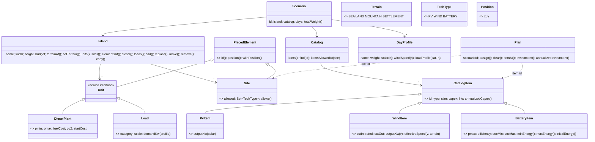

# Model design (`gr.ntua.medialab.energyisland.model`)

The model holds the domain data of a scenario and of a plan. It knows nothing about
JSON, files, or JavaFX.

## Principles

1. **No Gson in the model.** The `io` layer reads JSON with Gson's tree API (`JsonObject`), checks
   every field, and builds the model from it. This keeps field names (`soc_min`, `fuel`, ...) out of
   the domain and lets validation collect *all* errors instead of failing on the first.
   See `validation-and-loading.md`.
2. **Invalid states can be represented.** The editor must show invalid elements on the map
   (element on sea, two elements on one cell, `pmin > pmax`, ...). So constructors do not
   check value ranges or placement rules. A separate validator, still to be written, does that and
   reports every issue. Constructors only reject structural problems: a non-positive grid size,
   a day without 24 values, a duplicate catalog id.
3. **Immutable values in a mutable container.** Units, sites and catalog items are `record`s.
   `Island` is the only mutable class, and editing an element means replacing it (`replace`, `move`).
   This makes `Island.copy()` cheap and safe.
4. **Order matters.** The lists of sites, catalog items and days keep file order. The controller
   uses batteries in site order (guide §6).
5. **Plans refer to things by id.** A `Plan` maps site id to catalog item id, so it can be saved and
   reopened, and checked against an island that has changed since. This is the "plan incompatible
   with island" error the brief mentions.

## Classes

## Mapping from the scenario files

| File / field | Model |
|---|---|
| folder name | `Scenario.id()` |
| `island.json` `name`, `width`, `height`, `budget` | `Island` |
| `map[y].charAt(x)` | `Island.terrainAt(new Position(x, y))`, symbols in `Terrain` |
| `units[]` `DIESEL`: `pmin`, `pmax`, `fuel`, `co2`, `start` | `DieselPlant(pmin, pmax, fuelCost, co2, startCost)` |
| `units[]` `LOAD`: `category`, `scale` | `Load` |
| `sites[]`: `id`, `x`, `y`, `allowed` | `Site` (`allowed` becomes `Set<TechType>`) |
| `catalog.json` `items[]` `PV` | `PvItem` |
| … `WIND`: `cutin`, `rated`, `cutout` | `WindItem(cutIn, rated, cutOut)` |
| … `BATTERY`: `pmax`, `eff`, `soc_min`, `soc_max` | `BatteryItem(pmax, efficiency, socMin, socMax)` |
| `days/weights.json` + each CSV | `DayProfile(name = file name, weight, solar, windSpeed, loadProfiles)` |

## Formulas included in the model (guide §6)

| Rule | Where |
|---|---|
| Load demand = `scale × profile × 1000` kW | `Load.demandKw` |
| PV output = `size × solar` | `PvItem.outputKw` |
| Wind: ×1.15 on mountain, then the cubic curve between `cutin` and `rated`, `size` up to `cutout`, 0 otherwise | `WindItem.effectiveSpeed`, `WindItem.outputKw` |
| Battery start at 50 %, limits `soc_min × size` … `soc_max × size` | `BatteryItem.initialEnergy/minEnergy/maxEnergy` |
| Annualised investment `capex / life` | `CatalogItem.annualizedCapex`, `Plan.annualizedInvestment` |

Checked with jshell (2026-11-03): load 0.35 × 0.80 → 280 kW, wind curve edges (cut-in, rated, cut-out),
mountain 10 → 11.5 m/s, and plan investment and annualised cost.

## Not in the model (later steps)

- **Validation** (guide §7): done, see `validation-and-loading.md`.
- **Simulation** (`simulation` package): battery state while running, the hourly controller,
  energy balance, per-hour and per-day results, annual cost.
- **Optimiser encoding**: the optimiser will probably use an `int[]` (option index per site)
  internally for speed, and convert to `Plan` for results.

## Open questions

- What if `soc_min > 0.5` or `soc_max < 0.5`? The guide says each day starts at 50 %, which would then
  be outside the limits. Options: start at 50 % anyway, or clamp. To be decided with the simulation.
